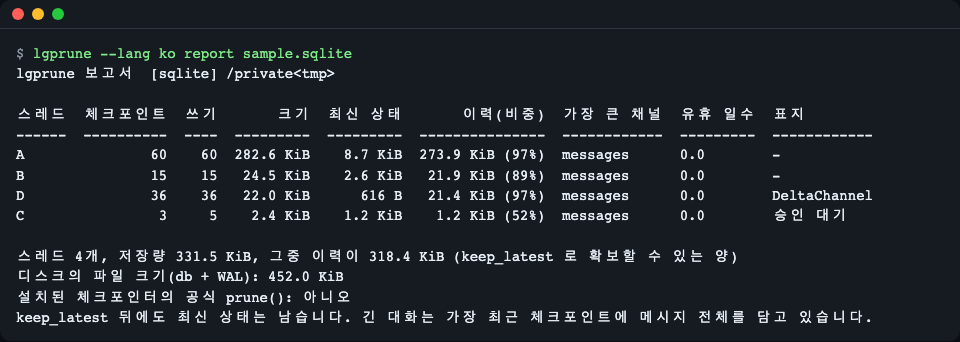
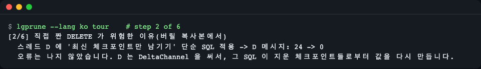
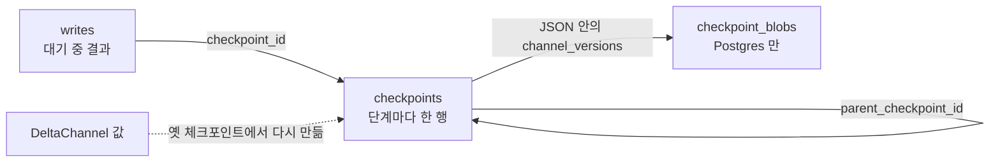
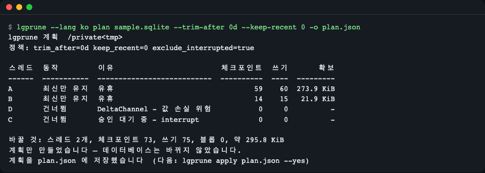
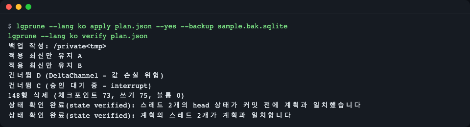
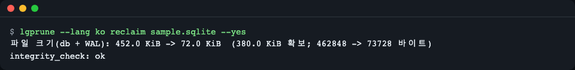

# lgprune

[English](README.md) | **한국어**

lgprune 은 LangGraph 체크포인트 데이터베이스(SQLite 또는 Postgres)에서 어디가 공간을 먹는지 보고하고, 재개·중단 대기·DeltaChannel 이 깨지지 않는 보존 정책을 계획한 뒤, 한 트랜잭션으로 적용하고, 디스크 공간까지 돌려받게 해 주는 도구입니다. 독립 오픈소스 도구이며 LangChain 과 관련이 없습니다.

```text
report  ->  plan  ->  apply  ->  reclaim
(어디가   (미리보기, (한 트랜잭션  (VACUUM +
 큰가?)    쓰기 없음)  으로 적용)   WAL 비우기)
```


*`lgprune report`: 스레드별 크기, 최신 상태 몫과 이력 몫, 표지(`DeltaChannel`, 승인 대기).*

## 이런 분께

- `SqliteSaver` 나 `PostgresSaver` 로 LangGraph 를 직접 운영하는데 `.sqlite` 파일이나 `checkpoint_blobs` 테이블이 계속 커지는 분.
- 주기적으로 정리하고 싶지만, `get_state()`·재개·사람 승인 대기(interrupt)를 깨뜨릴 수 있는 `DELETE` 문을 손으로 짜고 싶지 않은 분.
- 무엇이 지워질지 먼저 보고, 지운 뒤에도 상태가 그대로인지 확인하고 싶은 분.

## 설치

```bash
# 전제: uv (https://docs.astral.sh/uv/) - 필요하면 uv 가 Python 3.11+ 를 받아 옵니다
curl -LsSf https://astral.sh/uv/install.sh | sh

# GitHub 에서 설치 (Postgres 데이터베이스는 postgres extra 를 붙입니다)
uv tool install "lgprune @ git+https://github.com/LeeGyeongPil/lgprune"
uv tool install "lgprune[postgres] @ git+https://github.com/LeeGyeongPil/lgprune"
```

clone 해서 쓸 때는 아래 모든 명령이 `uv run lgprune ...` 입니다.

```bash
git clone https://github.com/LeeGyeongPil/lgprune && cd lgprune
uv sync
```

API 키·네트워크·추가 시스템 패키지가 필요 없습니다(Postgres 는 libpq 가 들어 있는 `psycopg[binary]` 를 씁니다).

## 빠르게 시작하기

```bash
uv run lgprune tour
```

`tour` 는 임시 예제 데이터베이스를 만들어 네 단계를 모두 돌려 보고 끝나면 지웁니다(1초 안팎). 예제는 **합성 데이터**입니다. 스레드 A·B·C·D 는 순수 함수 노드와 지어낸 메시지로 실제 LangGraph 그래프를 돌려 만든 진짜 체크포인트 행이지만, 모델도 실제 대화도 없습니다.

```text
[2/6] Why hand-written DELETE is dangerous (on a throw-away copy)
  naive 'keep only the latest checkpoint' SQL on thread D -> D messages: 24 -> 0
  No error was raised. D uses a DeltaChannel, which rebuilds its value from the checkpoints that SQL deleted.
...
skipped D (DeltaChannel)
skipped C (interrupted - waiting for a human)
deleted 148 rows (checkpoints 73, writes 75, blobs 0)
state verified: head state of 2 thread(s) matched the plan before commit
state verified: 2 planned thread(s) match the plan
D messages after lgprune: 24 -> 24
A get_state() equal to before: yes
A resumes normally: one more turn -> 42 messages
...
file size (db + WAL): 452.0 KiB -> 100.0 KiB  (saved 352.0 KiB; 462848 -> 102400 bytes)
integrity_check: ok
```

위 출력은 영어 화면입니다. 한국어로 보려면 `uv run lgprune --lang ko tour` 를 실행하세요(아래 스크린샷은 한국어 화면).


*둘러보기 2단계: 단순 SQL 정리는 오류 없이 스레드 D 를 비웁니다. lgprune 은 D 를 건드리지 않습니다.*

## 체크포인트 데이터베이스가 커지는 이유

LangGraph 는 단계마다 체크포인트(전체 상태의 스냅샷)와 그 단계의 대기 중 쓰기를 저장합니다. 대화 스레드는 스냅샷마다 `messages` 전체를 담으므로 저장량이 턴 수의 **제곱**에 가깝게 늘어납니다. 아래 스레드 A 가 97% 이력인 이유입니다.

여기서 두 가지가 따라옵니다.

- 오래된 체크포인트를 지우면(`keep_latest`) **이력 몫**이 줄어듭니다. **최신 상태 몫**은 남습니다. 가장 최근 체크포인트가 대화 전체를 담고 있기 때문입니다. `report` 가 두 숫자를 함께 보여 줘서 기대치를 맞출 수 있습니다.
- 테이블끼리는 데이터베이스 외래 키가 아니라 값으로(체크포인트 JSON 이 블롭을, 쓰기가 체크포인트 ID 를) 서로를 가리킵니다. 참조를 끊어도 데이터베이스가 막아 주지 않습니다.



- 체크포인트는 필요한 블롭 버전을 가리키고(Postgres), 쓰기는 체크포인트 ID 하나에 속합니다.
- 재개는 최신 체크포인트와 그 대기 쓰기를 읽습니다. 시간 되감기는 옛 체크포인트를 읽습니다.
- `DeltaChannel` 은 변경분만 저장하므로 값을 옛 체크포인트들에서 다시 만듭니다. 그것을 지우면 값이 조용히 비어 버립니다(위의 24 -> 0).


*`lgprune plan`: 무엇이 바뀌고 무엇을 왜 건너뛰는지. 데이터베이스는 바뀌지 않습니다.*

## 사용법

| 명령 | 하는 일 | 예 |
|---|---|---|
| `report DB` | 스레드별 행 수·바이트, 최신 대 이력 몫, 가장 큰 채널, 유휴 일수, 표지. `--json`, `--top N` | `lgprune report agent.sqlite` |
| `plan [DB]` | 정책으로 스레드를 고르고 계획을 출력, 선택적으로 저장. 읽기 전용 | `lgprune plan agent.sqlite --trim-after 1d -o plan.json` |
| `apply PLAN` | `--yes` 없으면 미리보기, 있으면 스레드마다 다시 검사하고 한 트랜잭션으로 삭제. `--backup PATH`(SQLite) | `lgprune apply plan.json --yes --backup agent.bak.sqlite` |
| `verify PLAN` | 현재 head 상태를 계획에 저장된 지문과 비교 | `lgprune verify plan.json` |
| `reclaim DB` | SQLite: `VACUUM` + WAL 비우기. Postgres: 안내, `--analyze` 는 `VACUUM (ANALYZE)`. `--yes` 필요 | `lgprune reclaim agent.sqlite --yes` |
| `sample OUT.sqlite` | 합성 예제 데이터베이스 만들기 | `lgprune sample sample.sqlite` |
| `tour` | 임시 예제로 전체 흐름 실행 | `lgprune tour` |

`DB` 는 파일 경로 또는 `postgresql://` URL 입니다(기본값 `LGPRUNE_DB`). 모든 옵션은 `lgprune 명령 --help` 로 봅니다.

**1. 큰 곳 찾기.** 먼저 `lgprune sample sample.sqlite` 로 예제를 만듭니다. 아래 크기는 예시 값이며 실행마다 조금씩 다릅니다. 아래 출력 예시는 영어 화면(`--lang en`)이고, 한국어 터미널에서는 같은 내용이 한국어로 나옵니다. 예제는 스레드 4개에 331.5 KiB, 그중 318.4 KiB 가 이력입니다.

```bash
lgprune report sample.sqlite
```

```text
thread  checkpoints  writes       size   latest  history (share)  top channel  idle days  flags
------  -----------  ------  ---------  -------  ---------------  -----------  ---------  -----------
A                60      60  282.6 KiB  8.7 KiB  273.9 KiB (97%)  messages     0.0        -
B                15      15   24.5 KiB  2.6 KiB   21.9 KiB (89%)  messages     0.0        -
D                36      36   21.9 KiB    610 B   21.3 KiB (97%)  messages     0.0        delta
C                 3       5    2.4 KiB  1.2 KiB    1.2 KiB (52%)  messages     0.0        interrupted
```

**2. 미리보기.** 유휴 시간은 가장 최근 체크포인트 기준입니다. 예제는 방금 만들었으므로 `--trim-after 0d` 로 모든 스레드를 유휴로 취급합니다.

```bash
lgprune plan sample.sqlite --trim-after 0d --keep-recent 0 -o plan.json
```

```text
thread  action       reason                             checkpoints  writes      frees
------  -----------  ---------------------------------  -----------  ------  ---------
A       keep_latest  idle                                        59      60  273.9 KiB
B       keep_latest  idle                                        14      15   21.9 KiB
D       skip         DeltaChannel                                 0       0          -
C       skip         interrupted - waiting for a human            0       0          -

to change: 2 threads, 73 checkpoints, 75 writes, 0 blobs, about 295.8 KiB
This is a plan only - the database was not changed.
plan saved to plan.json  (next: lgprune apply plan.json --yes)
```

`--yes` 없이 `lgprune apply plan.json` 을 실행하면 같은 표만 보여 주고 아무것도 바꾸지 않습니다.

**3. 적용과 확인.**

```bash
lgprune apply plan.json --yes --backup sample.bak.sqlite
lgprune verify plan.json
```

```text
backup written: sample.bak.sqlite
applied keep_latest A
applied keep_latest B
skipped D (DeltaChannel)
skipped C (interrupted - waiting for a human)
deleted 148 rows (checkpoints 73, writes 75, blobs 0)
state verified: head state of 2 thread(s) matched the plan before commit
state verified: 2 planned thread(s) match the plan
```


*`apply --yes` 는 한 트랜잭션 안에서 지우고, 커밋 전에 head 상태를 계획과 비교합니다.*

**4. 공간 돌려받기.** 행을 지워도 SQLite 파일은 줄지 않습니다. `reclaim` 은 여유 디스크를 확인하고 `VACUUM` 을 실행한 뒤 WAL 을 비웁니다.

```bash
lgprune reclaim sample.sqlite
lgprune reclaim sample.sqlite --yes
```

```text
Database is 452.0 KiB; about 376.0 KiB (94 free pages) can be given back. Re-run with --yes to run VACUUM (needs free disk space about the size of the database and an exclusive lock).
file size (db + WAL): 452.0 KiB -> 72.0 KiB  (saved 380.0 KiB; 462848 -> 73728 bytes)
integrity_check: ok
```


*`reclaim --yes`: WAL 을 포함한 파일 크기 전후.*

`VACUUM` 은 데이터베이스 크기만큼의 여유 디스크와 배타 잠금이 필요하므로 에이전트가 쉬는 때 실행하세요. 큰 데이터베이스에서는 시간이 걸릴 수 있습니다.

## 정책

플래그로 주거나 TOML 파일로 줍니다(플래그가 파일보다 우선): [`examples/policy.toml`](examples/policy.toml).

```toml
trim_after = "1d"          # 유휴 1일 이상: 최신 체크포인트만 남김(이력 삭제)
delete_after = "30d"       # 유휴 30일 이상: 스레드 통째 삭제
keep_recent = 20           # 가장 최근 활동한 20개 스레드는 건드리지 않음
exclude_interrupted = true # 사람 승인 대기 중인 스레드는 건드리지 않음
include = []               # 이 글롭에 맞는 스레드 ID 만 대상(비우면 전체)
exclude = ["prod-*"]       # 이 글롭에 맞는 스레드 ID 는 건드리지 않음
```

기간은 `30m`, `12h`, `1d` 같은 형식입니다. 기본값은 보수적입니다. `keep_recent` 는 10 이고 승인 대기 스레드는 제외됩니다. `--threads A,B` 는 이름으로 스레드를 고릅니다(`keep_recent` 보호는 건너뛰지만 모든 안전 검사는 그대로). `--now ISO` 는 다른 시각인 척 계산해 드라이런에 쓸 수 있습니다. 의미를 정확히 알아 두세요. `keep_latest` 는 **최신 체크포인트 이전의 이력을 모두** 지우므로, 그 스레드는 옛 단계로의 시간 되감기·재실행을 할 수 없게 됩니다.

## 안전 모델

세 단계이고, 모두 fail-closed(판단할 수 없으면 지우지 않음)입니다.

1. **전**: 계획은 미리보기입니다. `plan` 은 데이터베이스를 읽기 전용으로 엽니다.
2. **중**: `apply --yes` 는 쓰기 트랜잭션(SQLite 는 `BEGIN IMMEDIATE`)을 시작해 대상 스레드를 다시 검사한 뒤에야 지웁니다.
3. **커밋 전**: 남기는 head 마다 지문(최신 체크포인트 값과 대기 쓰기의 sha256)을 계획에 기록된 값과 비교합니다. 다르면 전부 롤백합니다.

| 위험 | lgprune 의 동작 |
|---|---|
| DeltaChannel 스레드(값을 이력에서 다시 만듦) | `keep_latest` 로 절대 줄이지 않음, 재정의 플래그 없음. 손으로 고친 계획도 트랜잭션 안에서 다시 거부(종료 코드 2, 롤백). 스레드 통째 삭제는 의도된 삭제이므로 허용 |
| interrupt 에서 대기 중인 스레드 | 기본으로 건너뜀(`--include-interrupted` 로 변경) |
| 옛 형식 체크포인트(v < 4) | 건너뜀(`legacy`) |
| 디코드할 수 없는 체크포인트(예: 암호화 직렬화기) | 건너뜀(`undecodable`) |
| `plan` 뒤에도 실행이 계속 씀 | 건너뜀(`stale`) |
| 서브그래프 네임스페이스 | SQLite 에서는 모든 네임스페이스의 head 를 남김 |
| 다른 쓰기 작업이 잠금을 쥠 | `--busy-timeout` 까지 기다린 뒤 코드 1 로 끝나며 아무것도 바꾸지 않음 |

종료 코드: `0` 성공, `1` 사용법·연결 오류, `2` 안전 거부(SQLite 데이터베이스가 아니거나 LangGraph 스키마가 없는 파일도 해당), `3` 상태 불일치(롤백됨).

지문의 한계: 저장된 값을 비교하므로 DeltaChannel 재구성은 볼 수 없습니다. 그래서 그런 스레드는 `keep_latest` 전에 거부합니다. 정리 중인 스레드에서 fork 나 replay 를 하지 마세요.

## Postgres 참고

- extra 를 설치합니다: `lgprune[postgres]`. 계획 파일에는 URL 을 **비밀번호 없이** 저장하고, `apply`·`verify` 는 `PGPASSWORD`, `~/.pgpass`, `--db URL` 을 씁니다.
- 실제 삭제는 공식 `PostgresSaver.prune`(langgraph-checkpoint-postgres 3.2.0 이상)이 합니다. lgprune 은 대상 선정·보고·커밋 전 비교·롤백을 더할 뿐 공식 함수를 대체하지 않습니다. 이전 버전이면 `apply` 가 코드 2 로 끝나며 업그레이드를 안내합니다.
- 리더와 저장소가 연결 하나를 함께 씁니다. 직렬화 실패·데드락은 3번 재시도하고, `--busy-timeout` 이 `lock_timeout` 이 됩니다.
- 지운 행은 autovacuum 이 다시 쓸 공간이 될 뿐 파일은 줄지 않습니다. `reclaim --analyze --yes` 는 `VACUUM (ANALYZE)` 를 실행합니다. `VACUUM FULL`·`pg_repack` 은 파일을 줄이지만 테이블을 잠그므로 점검 시간에 직접 실행하세요.
- 실제 Postgres 서버는 CI 에서 검증하고, 로컬 테스트는 PGlite(Node 로 도는 내장 Postgres)를 씁니다.

## Python API

```python
from datetime import timedelta
from lgprune import Policy, apply_plan, make_plan, open_store, verify_plan

with open_store("agent.sqlite") as store:        # 또는 "postgresql://..."
    plan = make_plan(store, Policy(trim_after=timedelta(days=1), keep_recent=20))
    for item in plan.items:
        print(item.thread_id, item.action, item.reason, item.rows)
    result = apply_plan(store, plan)
    print("deleted rows:", result.rows_deleted)
    print("skipped:", result.skipped)
    print("verified:", verify_plan(store, plan).ok)
```

예제 데이터베이스에서 `Policy(trim_after=timedelta(0), keep_recent=0)` 로 실행한 출력:

```text
A keep_latest idle {'checkpoints': 59, 'writes': 60, 'blobs': 0}
B keep_latest idle {'checkpoints': 14, 'writes': 15, 'blobs': 0}
D skip delta_channel {'checkpoints': 0, 'writes': 0, 'blobs': 0}
C skip interrupted {'checkpoints': 0, 'writes': 0, 'blobs': 0}
deleted rows: 148
skipped: {'D': 'delta_channel', 'C': 'interrupted'}
verified: True
```

예외는 모두 `LgpruneError` 에서 파생됩니다: `UnsafePruneError`, `VerifyMismatchError`, `UnsupportedBackendError`, `PlanFormatError`.

## cron 으로 돌리기

cron 이나 systemd timer 에서 `plan` 다음 `apply` 를 실행합니다. [`examples/cron.md`](examples/cron.md) 를 보세요. `0` 이 아닌 종료 코드는 모두 알림 대상으로 두세요.

## 설정

| 변수 | 뜻 |
|---|---|
| `LGPRUNE_DB` | `report`, `plan`, `reclaim` 의 기본 데이터베이스 |
| `LGPRUNE_LANG` | 화면 언어, `en` 또는 `ko` |
| `LGPRUNE_TEST_PG_URL` | 테스트용 Postgres(선택) |

[`.env.example`](.env.example) 를 보세요. **언어**: `--lang en|ko` 가 가장 우선이고, 다음이 `LGPRUNE_LANG`, 그다음 `LC_ALL`·`LC_MESSAGES`·`LANG` 입니다. 한국어가 아니면 영어로 돌아갑니다. JSON 의 키와 이유 코드는 언어와 무관합니다. 한국어 README 의 스크린샷은 한국어 화면입니다.

## 언제 쓰나

- 잘 맞는 경우: SQLite 나 Postgres 에 LangGraph 체크포인트를 직접 두고, 미리보기와 상태 확인이 있는 반복 가능한 정리를 원할 때.
- 이미 스레드를 직접 고른다면 공식 Postgres `prune` 만으로 충분합니다. SQLite 용 공식 저장소는 `delete_thread` 만 제공합니다(langgraph-checkpoint-sqlite 3.1.3 으로 확인, 2026-11-18).
- 호스팅된 LangGraph 배포를 쓴다면 그쪽 보존 설정을 확인하세요. [LangGraph 문서](https://docs.langchain.com/oss/python/langgraph/persistence)를 참고하세요.

## 한계

- `AsyncSqliteSaver`·`AsyncPostgresSaver`, MongoDB, Redis, LangGraph.js 저장소는 지원하지 않습니다. 내 그래프의 `get_state` 를 호출해 비교하는 `--graph` 검증도 아직 없습니다.
- `report`·`plan` 은 SQLite 체크포인트를 전부 디코드하므로 아주 큰 데이터베이스에서는 느립니다(`--top` 은 표시만 줄입니다).
- WAL 모드 SQLite 파일을 읽기 전용으로 열면 SQLite 가 빈 `-wal`·`-shm` 파일을 만듭니다. 데이터베이스 내용은 그대로입니다.
- argparse 가 만드는 일부 메시지(예: 잘못된 선택지)는 한국어 모드에서도 영어입니다.

## 자주 겪는 문제

| 증상 | 원인 | 해결 |
|---|---|---|
| `the database is busy ... Nothing was changed` (종료 1) | 다른 프로세스가 쓰기 잠금을 쥐고 있음 | 에이전트가 쉴 때 실행하거나 `--busy-timeout 30s` |
| 스레드가 `stale - changed after plan` 으로 표시됨 | `plan` 뒤에 새 체크포인트가 생김 | 다시 plan 하고 apply |
| `refused keep_latest ... DeltaChannel ...` (종료 2) | DeltaChannel 스레드를 줄이도록 계획을 고쳤음 | 계획을 새로 만들기. 그런 스레드는 절대 줄이지 않음 |
| `apply` 뒤에도 파일이 안 줄어듦 | SQLite 가 비운 페이지를 그대로 둠 | `lgprune reclaim DB --yes` |
| Postgres: prune 관련 종료 2 | 설치된 `langgraph-checkpoint-postgres` 가 3.2.0 보다 오래됨 | `uv tool install --upgrade "lgprune[postgres] @ git+https://github.com/LeeGyeongPil/lgprune"` |
| 화면 언어가 다름 | `LANG` 이 한국어 | `--lang en` 또는 `LGPRUNE_LANG=en` |

## 개발

```bash
uv sync
uv run pytest -q                 # SQLite 테스트. 서버가 없으면 Postgres 테스트는 건너뜀
npm ci --prefix tests/pglite     # 선택: Postgres 테스트를 PGlite 로 실행(Node 필요)
uv run pytest -q -m pg
```

버그·제안은 이슈로 남겨 주세요. 변경 기록은 [CHANGELOG.md](CHANGELOG.md).

## 라이선스

MIT. 예제 데이터는 도구가 직접 생성하며 제3자 콘텐츠가 없습니다.
