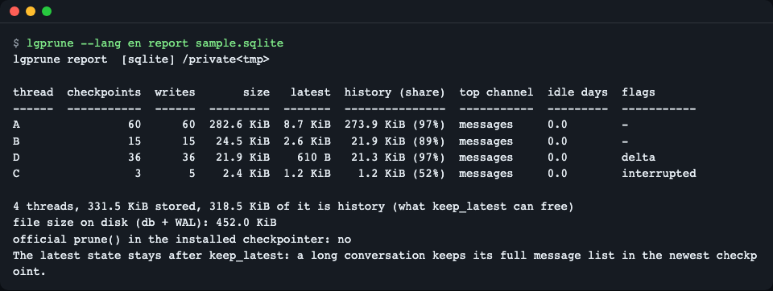
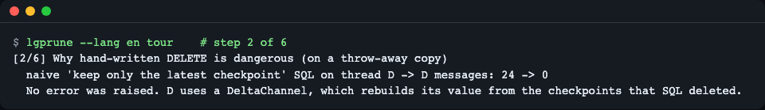
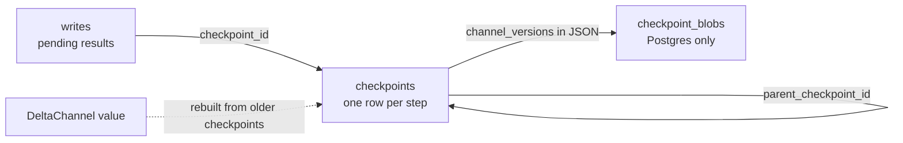
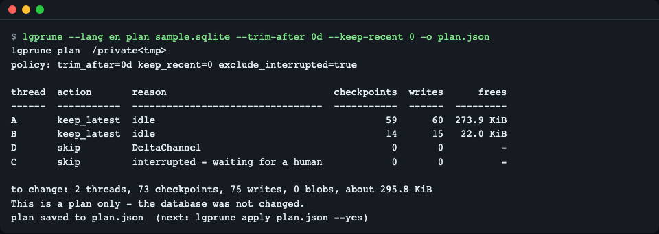
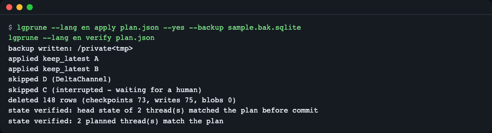
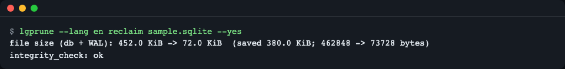

# lgprune

**English** | [한국어](README.ko.md)

lgprune reports what fills your LangGraph checkpoint database (SQLite or Postgres), plans a retention policy that keeps resume, interrupts and DeltaChannel threads working, applies it in one transaction, and gives the disk space back. It is an independent open-source tool and is not affiliated with LangChain.

```text
report  ->  plan  ->  apply  ->  reclaim
(what is   (preview, (one       (VACUUM +
 big?)      no write)  transaction) WAL truncate)
```


*`lgprune report`: size per thread, the latest-state share versus the history share, and flags (`delta`, `interrupted`).*

## Who this is for

- You run LangGraph with `SqliteSaver` or `PostgresSaver` yourself, and the `.sqlite` file or the `checkpoint_blobs` table keeps growing.
- You want to clean up on a schedule, but you do not want to hand-write `DELETE` statements that can break `get_state()`, resume or human-in-the-loop interrupts.
- You want to see what will be deleted first, and to know the state is still the same afterwards.

## Install

```bash
# prerequisite: uv (https://docs.astral.sh/uv/) - Python 3.11+ is fetched by uv if needed
curl -LsSf https://astral.sh/uv/install.sh | sh

# from GitHub (add the postgres extra for Postgres databases)
uv tool install "lgprune @ git+https://github.com/LeeGyeongPil/lgprune"
uv tool install "lgprune[postgres] @ git+https://github.com/LeeGyeongPil/lgprune"
```

Or work from a clone, where every command below is `uv run lgprune ...`:

```bash
git clone https://github.com/LeeGyeongPil/lgprune && cd lgprune
uv sync
```

No API key, no network and no extra system package is needed (Postgres uses `psycopg[binary]`, which bundles libpq).

## Quick start

```bash
uv run lgprune tour
```

`tour` creates a throw-away sample database, runs all four steps on it and deletes it afterwards (about a second). The sample is **synthetic**: threads A, B, C and D are real LangGraph graphs with plain function nodes and made-up messages, so the rows are genuine checkpoint rows, but there is no model and no real conversation behind them.

```text
[2/6] Why hand-written DELETE is dangerous (on a throw-away copy)
  naive 'keep only the latest checkpoint' SQL on thread D -> D messages: 24 -> 0
  No error was raised. D uses a DeltaChannel, which rebuilds its value from the checkpoints that SQL deleted.
...
skipped D (DeltaChannel)
skipped C (interrupted - waiting for a human)
deleted 148 rows (checkpoints 73, writes 75, blobs 0)
state verified: head state of 2 thread(s) matched the plan before commit
state verified: 2 planned thread(s) match the plan
D messages after lgprune: 24 -> 24
A get_state() equal to before: yes
A resumes normally: one more turn -> 42 messages
...
file size (db + WAL): 452.0 KiB -> 100.0 KiB  (saved 352.0 KiB; 462848 -> 102400 bytes)
integrity_check: ok
```


*Step 2 of the tour: a plain SQL cleanup empties thread D without any error. lgprune refuses to touch it.*

## Why a checkpoint database grows

LangGraph saves a checkpoint (a snapshot of the whole state) after every step, plus the pending writes of that step. A chat thread stores its full `messages` list in every snapshot, so the stored size grows roughly with the **square** of the number of turns. That is why one long thread (A below) is 97% history.

Two things follow from this:

- Deleting old checkpoints (`keep_latest`) frees the **history share**. The **latest-state share** stays, because the newest checkpoint still holds the whole conversation. `report` shows both numbers so you know what to expect.
- The tables point at each other by values (a checkpoint's JSON refers to blobs, writes refer to a checkpoint ID), not by database foreign keys. The database does not stop you from cutting a reference:



- A checkpoint says which blob versions it needs (Postgres), and a write belongs to one checkpoint ID.
- Resume reads the newest checkpoint and its pending writes. Time travel reads older ones.
- A `DeltaChannel` stores only changes, so its value is rebuilt from older checkpoints. Delete those and the value silently becomes empty (the 24 -> 0 above).


*`lgprune plan`: what would change, what is skipped and why. The database is not modified.*

## Usage

| Command | What it does | Example |
|---|---|---|
| `report DB` | Per-thread rows and bytes, latest vs history share, top channel, idle days, flags. `--json`, `--top N` | `lgprune report agent.sqlite` |
| `plan [DB]` | Choose threads by policy, print the plan, optionally save it. Read-only | `lgprune plan agent.sqlite --trim-after 1d -o plan.json` |
| `apply PLAN` | Preview without `--yes`; with `--yes` re-check each thread and delete in one transaction. `--backup PATH` (SQLite) | `lgprune apply plan.json --yes --backup agent.bak.sqlite` |
| `verify PLAN` | Compare the current head state with the fingerprints saved in the plan | `lgprune verify plan.json` |
| `reclaim DB` | SQLite: `VACUUM` + WAL truncate. Postgres: advice, `--analyze` runs `VACUUM (ANALYZE)`. Needs `--yes` | `lgprune reclaim agent.sqlite --yes` |
| `sample OUT.sqlite` | Write the synthetic sample database | `lgprune sample sample.sqlite` |
| `tour` | The whole flow on a temporary sample | `lgprune tour` |

`DB` is a file path or a `postgresql://` URL (default: `LGPRUNE_DB`). `lgprune COMMAND --help` lists every option.

**1. Find what is big.** First create the sample with `lgprune sample sample.sqlite`. Sizes below are example values and vary a little per run. The sample has 331.5 KiB in four threads, 318.4 KiB of it history:

```bash
lgprune report sample.sqlite
```

```text
thread  checkpoints  writes       size   latest  history (share)  top channel  idle days  flags
------  -----------  ------  ---------  -------  ---------------  -----------  ---------  -----------
A                60      60  282.6 KiB  8.7 KiB  273.9 KiB (97%)  messages     0.0        -
B                15      15   24.5 KiB  2.6 KiB   21.9 KiB (89%)  messages     0.0        -
D                36      36   21.9 KiB    610 B   21.3 KiB (97%)  messages     0.0        delta
C                 3       5    2.4 KiB  1.2 KiB    1.2 KiB (52%)  messages     0.0        interrupted
```

**2. Preview.** Idle time is measured from the newest checkpoint. The sample was just created, so `--trim-after 0d` makes every thread count as idle:

```bash
lgprune plan sample.sqlite --trim-after 0d --keep-recent 0 -o plan.json
```

```text
thread  action       reason                             checkpoints  writes      frees
------  -----------  ---------------------------------  -----------  ------  ---------
A       keep_latest  idle                                        59      60  273.9 KiB
B       keep_latest  idle                                        14      15   21.9 KiB
D       skip         DeltaChannel                                 0       0          -
C       skip         interrupted - waiting for a human            0       0          -

to change: 2 threads, 73 checkpoints, 75 writes, 0 blobs, about 295.8 KiB
This is a plan only - the database was not changed.
plan saved to plan.json  (next: lgprune apply plan.json --yes)
```

`lgprune apply plan.json` without `--yes` prints the same table and changes nothing.

**3. Apply and verify.**

```bash
lgprune apply plan.json --yes --backup sample.bak.sqlite
lgprune verify plan.json
```

```text
backup written: sample.bak.sqlite
applied keep_latest A
applied keep_latest B
skipped D (DeltaChannel)
skipped C (interrupted - waiting for a human)
deleted 148 rows (checkpoints 73, writes 75, blobs 0)
state verified: head state of 2 thread(s) matched the plan before commit
state verified: 2 planned thread(s) match the plan
```


*`apply --yes` deletes inside one transaction and compares the head state with the plan before it commits.*

**4. Give the space back.** Deleting rows does not shrink a SQLite file. `reclaim` checks free disk space, runs `VACUUM` and truncates the WAL:

```bash
lgprune reclaim sample.sqlite
lgprune reclaim sample.sqlite --yes
```

```text
Database is 452.0 KiB; about 376.0 KiB (94 free pages) can be given back. Re-run with --yes to run VACUUM (needs free disk space about the size of the database and an exclusive lock).
file size (db + WAL): 452.0 KiB -> 72.0 KiB  (saved 380.0 KiB; 462848 -> 73728 bytes)
integrity_check: ok
```


*`reclaim --yes`: file size before and after, including the WAL.*

`VACUUM` needs free disk space about the size of the database and an exclusive lock, so run it when the agent is idle. On a large database it can take a while.

## Policy

Pass flags, or a TOML file (flags override the file): [`examples/policy.toml`](examples/policy.toml).

```toml
trim_after = "1d"          # idle >= 1 day: keep only the latest checkpoint (history is removed)
delete_after = "30d"       # idle >= 30 days: delete the whole thread
keep_recent = 20           # the 20 most recently active threads are never touched
exclude_interrupted = true # threads waiting for a human are never touched
include = []               # only thread IDs matching these globs (empty = all)
exclude = ["prod-*"]       # thread IDs matching these globs are never touched
```

Durations are `30m`, `12h`, `1d` and so on. Defaults are conservative: `keep_recent` is 10 and interrupted threads are excluded. `--threads A,B` picks threads by name (the `keep_recent` protection is skipped, every safety check still applies). `--now ISO` pretends it is another time, which is handy for dry runs. Keep the exact meaning in mind: `keep_latest` removes **all history before the latest checkpoint**, so time travel and replay from older steps stop working for that thread.

## Safety model

Three steps, each one fails closed (when lgprune cannot tell, it does not delete):

1. **Before**: the plan is a preview. `plan` opens the database read-only.
2. **During**: `apply --yes` starts a write transaction (`BEGIN IMMEDIATE` on SQLite), re-checks every target thread, and only then deletes.
3. **Before commit**: it compares a fingerprint (sha256 of the latest checkpoint values and pending writes) of each kept head with the value recorded in the plan. A mismatch rolls everything back.

| Risk | What lgprune does |
|---|---|
| DeltaChannel thread (value rebuilt from history) | Never trimmed with `keep_latest`; no override flag. A plan edited by hand is refused again inside the transaction (exit code 2, rolled back). Deleting a whole thread is still allowed because that is intended |
| Thread waiting at an interrupt | Skipped by default (`--include-interrupted` to change) |
| Checkpoints in the old format (v < 4) | Skipped (`legacy`) |
| Checkpoints it cannot decode (for example an encrypted serializer) | Skipped (`undecodable`) |
| The run kept writing after `plan` | Skipped (`stale`) |
| Sub-graph namespaces | The head of every namespace is kept on SQLite |
| Another writer holds the lock | Waits up to `--busy-timeout`, then exits with code 1 and changes nothing |

Exit codes: `0` ok, `1` usage or connection error, `2` safety refusal (also a file that is not a SQLite database or has no LangGraph schema), `3` state mismatch (rolled back).

Limits of the fingerprint: it compares stored values, so it cannot see a DeltaChannel rebuild. That is why such threads are refused before any `keep_latest`. Do not fork or replay a thread while it is being trimmed.

## Postgres notes

- Install the extra: `lgprune[postgres]`. The plan file stores the URL **without the password**; `apply` and `verify` use `PGPASSWORD`, `~/.pgpass` or `--db URL`.
- The deletion itself is done by the official `PostgresSaver.prune` (langgraph-checkpoint-postgres 3.2.0 or newer). lgprune adds target selection, the report, the pre-commit comparison and the rollback, and does not replace the official function. With an older package `apply` exits with code 2 and asks you to upgrade.
- One connection is shared by the reader and the saver. Serialization failures and deadlocks are retried 3 times; `--busy-timeout` sets `lock_timeout`.
- Deleted rows become reusable space for autovacuum, the files do not shrink. `reclaim --analyze --yes` runs `VACUUM (ANALYZE)`. `VACUUM FULL` or `pg_repack` shrink files but lock tables, so run them yourself in a maintenance window.
- A real Postgres server is exercised in CI; local tests use PGlite (an embedded Postgres in Node).

## Python API

```python
from datetime import timedelta
from lgprune import Policy, apply_plan, make_plan, open_store, verify_plan

with open_store("agent.sqlite") as store:        # or "postgresql://..."
    plan = make_plan(store, Policy(trim_after=timedelta(days=1), keep_recent=20))
    for item in plan.items:
        print(item.thread_id, item.action, item.reason, item.rows)
    result = apply_plan(store, plan)
    print("deleted rows:", result.rows_deleted)
    print("skipped:", result.skipped)
    print("verified:", verify_plan(store, plan).ok)
```

Output on the sample database with `Policy(trim_after=timedelta(0), keep_recent=0)`:

```text
A keep_latest idle {'checkpoints': 59, 'writes': 60, 'blobs': 0}
B keep_latest idle {'checkpoints': 14, 'writes': 15, 'blobs': 0}
D skip delta_channel {'checkpoints': 0, 'writes': 0, 'blobs': 0}
C skip interrupted {'checkpoints': 0, 'writes': 0, 'blobs': 0}
deleted rows: 148
skipped: {'D': 'delta_channel', 'C': 'interrupted'}
verified: True
```

Errors derive from `LgpruneError`: `UnsafePruneError`, `VerifyMismatchError`, `UnsupportedBackendError`, `PlanFormatError`.

## Running from cron

`plan` then `apply` from cron or a systemd timer; see [`examples/cron.md`](examples/cron.md). Alert on any exit code other than `0`.

## Configuration

| Variable | Meaning |
|---|---|
| `LGPRUNE_DB` | Default database for `report`, `plan`, `reclaim` |
| `LGPRUNE_LANG` | Screen language, `en` or `ko` |
| `LGPRUNE_TEST_PG_URL` | Postgres for the test suite (optional) |

See [`.env.example`](.env.example). **Language**: `--lang en|ko` wins, then `LGPRUNE_LANG`, then `LC_ALL`, `LC_MESSAGES`, `LANG`; anything that is not Korean falls back to English. JSON keys and reason codes do not depend on the language. Screenshots in the Korean README show the Korean screen.

## When to use it

- Good fit: you self-host LangGraph checkpoints in SQLite or Postgres and want a repeatable, previewable cleanup with a state check.
- Using the official Postgres `prune` alone is enough if you already pick the threads yourself. For SQLite, the official saver offers `delete_thread` only (checked with langgraph-checkpoint-sqlite 3.1.3, 2026-11-18).
- Using a hosted LangGraph deployment: check its own retention settings, see the [LangGraph docs](https://docs.langchain.com/oss/python/langgraph/persistence).

## Limitations

- No `AsyncSqliteSaver` / `AsyncPostgresSaver`, MongoDB, Redis or LangGraph.js stores. No `--graph` check that calls `get_state` on your own graph yet.
- `report` and `plan` decode every SQLite checkpoint, which is slow on very large databases (`--top` only limits the display).
- A read-only open of a WAL-mode SQLite file makes SQLite create empty `-wal` and `-shm` files. The database content is unchanged.
- Some argparse-generated messages (for example an invalid choice) stay in English in Korean mode.

## Troubleshooting

| Symptom | Cause | Fix |
|---|---|---|
| `the database is busy ... Nothing was changed` (exit 1) | Another process holds the write lock | Run when the agent is idle or raise `--busy-timeout 30s` |
| A thread shows `stale - changed after plan` | It got a new checkpoint after `plan` | Plan again and apply |
| `refused keep_latest ... DeltaChannel ...` (exit 2) | A plan was edited to trim a DeltaChannel thread | Make a new plan; those threads are never trimmed |
| File does not shrink after `apply` | SQLite keeps freed pages | `lgprune reclaim DB --yes` |
| Postgres: exit 2 about prune | The installed `langgraph-checkpoint-postgres` is older than 3.2.0 | `uv tool install --upgrade "lgprune[postgres] @ git+https://github.com/LeeGyeongPil/lgprune"` |
| Screen is in the wrong language | `LANG` is Korean | `--lang en` or `LGPRUNE_LANG=en` |

## Development

```bash
uv sync
uv run pytest -q                 # SQLite tests; Postgres tests skip without a server
npm ci --prefix tests/pglite     # optional: lets the Postgres tests run on PGlite (needs Node)
uv run pytest -q -m pg
```

Bugs and ideas are welcome as issues. Changes are listed in [CHANGELOG.md](CHANGELOG.md).

## License

MIT. The sample data is generated by the tool itself and has no third-party content.
